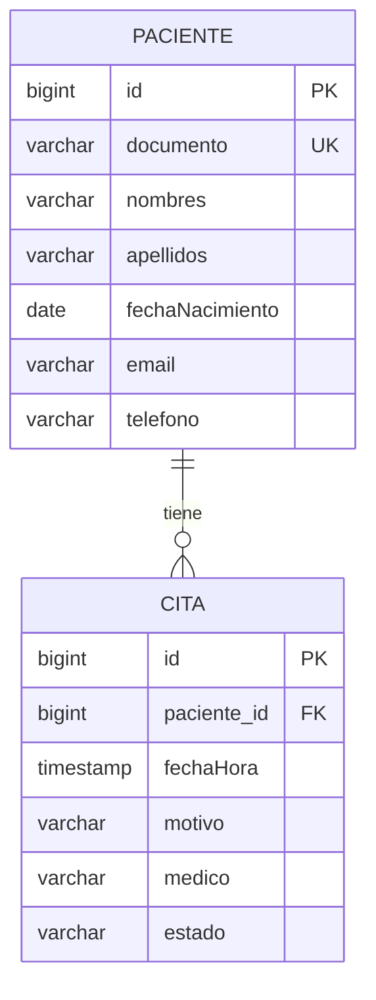

# Clínica Médica — API REST

**Estudiante:** Sofía Barahona Marín

**Tema:** Clínica Médica · **Relación:** Paciente 1 : N Cita

API REST con Spring Boot, Java 21 y Maven. Permite registrar pacientes y gestionar sus citas mediante CRUD completo. Incluye arquitectura en capas, validación, manejo de errores, pruebas de integración y Docker. Desplegada en **AWS EC2**, región **us-east-2 (Ohio)**.

## Enlaces de entrega

Enlaces del proyecto y del despliegue verificado el 23 de octubre de 2026:

- Repositorio: [github.com/sbarahona-m17/clinica-api](https://github.com/sbarahona-m17/clinica-api).
- API en AWS: [http://3.145.8.190](http://3.145.8.190).
- Salud del servicio: [http://3.145.8.190/actuator/health](http://3.145.8.190/actuator/health).
- Pacientes: [http://3.145.8.190/api/pacientes](http://3.145.8.190/api/pacientes).
- Citas: [http://3.145.8.190/api/citas](http://3.145.8.190/api/citas).

El despliegue pasó las pruebas HTTP de ambos CRUD y la relación 1:N. Es una demostración temporal: la instancia debe permanecer encendida durante la revisión. Usa `http://`; la configuración no incluye HTTPS. La IPv4 puede cambiar al detener y volver a iniciar la instancia.

## Entidades y relación



Un paciente puede tener cero o muchas citas. Cada cita pertenece a exactamente un paciente existente. Se usa `@OneToMany(mappedBy = "paciente")` en Paciente y `@ManyToOne` con `@JoinColumn` en Cita. La base de datos exige la clave foránea y un documento único por paciente.

El médico es un campo de texto de Cita; las dos entidades del proyecto son Paciente y Cita.

## Arquitectura

```text
src/main/java/com/sofia/clinica/
├── ClinicaApplication.java
├── controller/    Rutas HTTP y códigos de respuesta
├── service/       Reglas de negocio y transacciones
├── repository/    Acceso a datos con Spring Data JPA
├── entity/        Paciente, Cita y enum EstadoCita
├── dto/           Objetos de entrada/salida y validaciones
└── exception/     Respuestas de error centralizadas
```

Flujo: **Controller → Service → Repository → Entity / base de datos**. Los controladores no acceden directamente a repositorios. Los DTO evitan exponer entidades JPA y referencias circulares al convertir la relación a JSON.

## Ejecutar en Windows o IntelliJ

Requisito: **JDK 21 o superior**. Maven se descarga automáticamente mediante el wrapper incluido; necesitas conexión a internet la primera vez.

```powershell
.\mvnw.cmd clean verify
.\mvnw.cmd spring-boot:run
```

En Linux/macOS:

```bash
sh mvnw clean verify
sh mvnw spring-boot:run
```

En IntelliJ abre `pom.xml` como proyecto Maven, selecciona un JDK 21 o superior y ejecuta `ClinicaApplication`.

- Inicio: <http://localhost:8080>.
- Pacientes: <http://localhost:8080/api/pacientes>.
- Citas: <http://localhost:8080/api/citas>.
- Salud: <http://localhost:8080/actuator/health>, respuesta `{"status":"UP"}`.

Por defecto se activa el perfil `local` con **H2 en archivo** (`data/clinica`). Conserva los datos entre reinicios. Las pruebas usan H2 en memoria, separado de los datos locales. El perfil `prod` utiliza PostgreSQL.

## Ejecutar con Docker y PostgreSQL

Requisito: Docker Desktop iniciado en modo de contenedores Linux, con Docker Compose.

```powershell
docker compose up --build -d
docker compose ps
docker compose logs -f api
```

La construcción ejecuta las pruebas y genera el JAR en una etapa Maven; la imagen final contiene el runtime Java 21 y ejecuta la API con un usuario sin privilegios. Abre <http://localhost:8080/actuator/health> cuando termine el arranque.

Para detener los contenedores conservando los datos:

```powershell
docker compose down
```

PostgreSQL guarda los datos en el volumen `postgres_data`. No agregues `-v` a `down` si quieres conservarlos. El puerto de PostgreSQL no se publica al exterior. La contraseña predeterminada de `compose.yaml` es únicamente para desarrollo local.

También puedes construir y ejecutar la imagen por separado con H2:

```powershell
docker build -t clinica-api:1.0.0 .
docker run --rm -p 8080:8080 clinica-api:1.0.0
```

En este último comando los datos H2 desaparecen al eliminar el contenedor; usa Compose para verificar persistencia con PostgreSQL.

## Endpoints

Todos los cuerpos de entrada son JSON y requieren `Content-Type: application/json`. Los identificadores se generan automáticamente.

| Método | Ruta | Operación | Respuesta correcta |
| --- | --- | --- | --- |
| GET | `/api/pacientes` | Listar pacientes | 200 + arreglo |
| GET | `/api/pacientes/{id}` | Consultar paciente | 200 + objeto |
| POST | `/api/pacientes` | Crear paciente | 201 + objeto y cabecera Location |
| PUT | `/api/pacientes/{id}` | Actualizar paciente completo | 200 + objeto |
| DELETE | `/api/pacientes/{id}` | Eliminar paciente sin citas | 204 |
| GET | `/api/pacientes/{id}/citas` | Listar citas del paciente | 200 + arreglo |
| GET | `/api/citas` | Listar citas | 200 + arreglo |
| GET | `/api/citas/{id}` | Consultar cita | 200 + objeto |
| POST | `/api/citas` | Crear cita | 201 + objeto y cabecera Location |
| PUT | `/api/citas/{id}` | Actualizar cita completa | 200 + objeto |
| DELETE | `/api/citas/{id}` | Eliminar cita | 204 |
| GET | `/actuator/health` | Verificar servicio y base de datos | 200 si está disponible |

Las listas sin registros devuelven `[]`. Consultar las citas de un paciente inexistente devuelve 404. Las citas se ordenan por fecha ascendente.

### Crear un paciente

`POST /api/pacientes`

```json
{
  "documento": "1001234567",
  "nombres": "Ana",
  "apellidos": "Pérez",
  "fechaNacimiento": "2000-05-10",
  "email": "ana@example.com",
  "telefono": "3001234567"
}
```

Ejemplo de respuesta **201 Created**:

```json
{
  "id": 1,
  "documento": "1001234567",
  "nombres": "Ana",
  "apellidos": "Pérez",
  "fechaNacimiento": "2000-05-10",
  "email": "ana@example.com",
  "telefono": "3001234567"
}
```

### Crear una cita

`POST /api/citas`. Usa el `id` real del paciente creado:

```json
{
  "pacienteId": 1,
  "fechaHora": "2026-11-15T09:00:00",
  "motivo": "Control general",
  "medico": "Dra. Laura Gómez",
  "estado": "PROGRAMADA"
}
```

La respuesta **201 Created** contiene los mismos campos y el `id` de la cita.

### Actualizar y eliminar

`PUT /api/pacientes/1` usa todos los campos del ejemplo de paciente. Para cambiar el estado de una cita, envía a `PUT /api/citas/1` todos los campos de cita con `"estado": "COMPLETADA"` o `"CANCELADA"`. También permite cambiar `pacienteId` por el de otro paciente existente.

Para eliminar primero la cita y después el paciente:

```text
DELETE /api/citas/1
DELETE /api/pacientes/1
```

Cada eliminación correcta devuelve **204 No Content**, sin cuerpo. Hay solicitudes listas para IntelliJ en [`requests.http`](requests.http).

## Validaciones y errores

- Paciente: todos los campos son obligatorios; documento único de hasta 30 caracteres; nombres y apellidos de hasta 100; email válido de hasta 150; teléfono de hasta 25; fecha de nacimiento no futura.
- Cita: paciente existente e identificador positivo; fecha y hora obligatorias; motivo de hasta 250 caracteres; médico de hasta 120; estado `PROGRAMADA`, `COMPLETADA` o `CANCELADA`.
- Fecha de cita: formato `yyyy-MM-dd'T'HH:mm:ss`, interpretado como hora local de la clínica en Colombia. Se permiten citas pasadas para registrar el historial.
- No se elimina automáticamente el historial de citas al borrar un paciente. Si tiene citas, devuelve **409**; primero hay que eliminarlas explícitamente.
- No se implementan reglas de disponibilidad ni detección de cruces de agenda; el alcance es el CRUD solicitado.

| Código | Significado |
| --- | --- |
| 400 | Campos inválidos, JSON incorrecto, fecha o estado inválido |
| 404 | Paciente o cita inexistente |
| 409 | Documento duplicado o paciente con citas asociadas |

Ejemplo de error:

```json
{
  "timestamp": "2026-10-23T15:00:00Z",
  "status": 404,
  "message": "Paciente no encontrado: 99",
  "path": "/api/pacientes/99",
  "errors": {}
}
```

Los errores de validación incluyen los campos en `errors`.

## Variables de entorno

| Variable | Uso |
| --- | --- |
| `PORT` | Puerto interno de la API; predeterminado 8080 |
| `SPRING_PROFILES_ACTIVE` | `prod` para PostgreSQL; `local` para H2 |
| `DB_HOST` | Host de PostgreSQL; en Compose es `db` |
| `DB_PORT` | Puerto PostgreSQL; predeterminado 5432 |
| `DB_NAME` | Nombre de la base de datos |
| `DB_USER` | Usuario PostgreSQL |
| `DB_PASSWORD` | Contraseña PostgreSQL |

Se usa `ddl-auto=update` para crear/actualizar las tablas de este proyecto académico. No incluye autenticación: usar únicamente datos ficticios en la demostración pública.

## Desplegar en AWS

Sigue la guía [`docs/AWS.md`](docs/AWS.md): EC2 con Ubuntu, Docker Compose, PostgreSQL persistente y API pública en el puerto 80. Usa [`compose.aws.yaml`](compose.aws.yaml), que exige definir una contraseña en `.env` y reinicia los servicios junto al servidor.

## Pruebas

```powershell
.\mvnw.cmd clean verify
```

Las 11 pruebas de integración verifican el CRUD de ambas entidades, la relación 1:N, el cambio de paciente de una cita, transacciones ante actualizaciones inválidas, documentos duplicados, campos inválidos, recursos inexistentes y protección del historial. Consulta los resultados de la verificación local y en AWS en [`docs/VERIFICACION.md`](docs/VERIFICACION.md).

Para verificar el servicio real (local, Docker o AWS) con datos ficticios:

```powershell
powershell -ExecutionPolicy Bypass -File scripts/smoke-test.ps1 -BaseUrl http://localhost:8080
```

El script crea sus propios registros, comprueba ambos CRUD, la relación y un error 409, y elimina los registros creados al terminar.

## Actualizar el repositorio y entregar

El repositorio está publicado en [GitHub](https://github.com/sbarahona-m17/clinica-api). Para subir cambios desde la raíz del proyecto:

   ```powershell
   git add .
   git commit -m "Actualizar API de clinica"
   git push
   ```

Entrega el enlace del repositorio y la URL pública de la sección **Enlaces de entrega**. Mantén EC2 encendida durante al menos tres horas desde que compartas el enlace con el profesor. La instancia no se detiene automáticamente; consulta la guía AWS para detenerla después de la revisión.

## Referencias

- [Spring Boot 3.5: requisitos y documentación](https://docs.spring.io/spring-boot/3.5/system-requirements.html).
- [AWS: comenzar con Amazon EC2](https://docs.aws.amazon.com/AWSEC2/latest/UserGuide/EC2_GetStarted.html).
- [Docker: instalación en Ubuntu](https://docs.docker.com/engine/install/ubuntu/).
